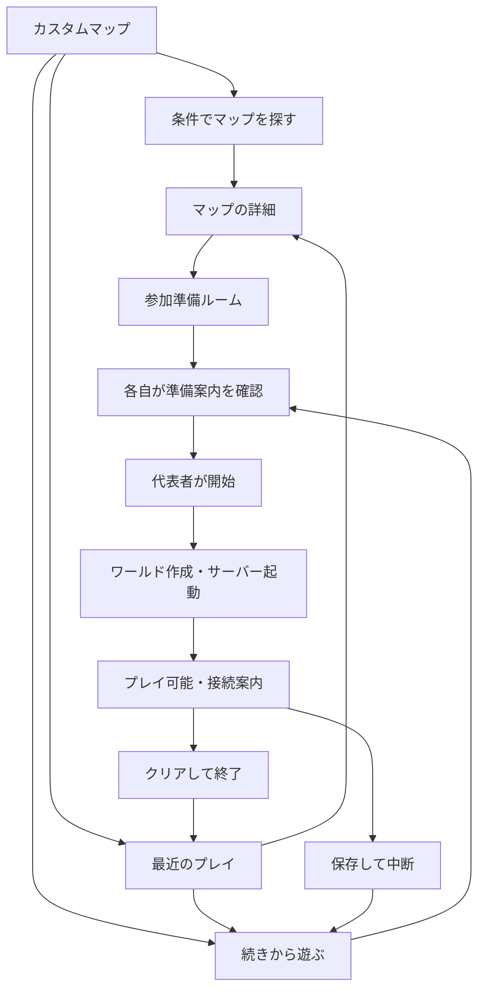

# カスタムマップBot: Discord UX・検索・参加準備の設計

設計日: 2026-10-25。対象は既存Discord Botへの機能追加である。本書は設計仕様であり、実装・本番反映・全マップの動作確認は未実施である。実機・配布元の調査と実行環境の構成は [運用設計](escape-worlds-plan.md)を参照する。

最新仕様の再確認に基づき、Components V2・選択式Modal・コマンド入口を改訂した。APIとSDKの根拠、コンポーネント構成、応答順序は [Discordプラットフォーム適用設計](escape-discord-platform.md)を参照する。

### Discord上の表示名

機能名・画面区分は「カスタムマップ」に統一する。Paper / Forge等は「通常サーバー」、本機能は「カスタムマップ」として別の区画に表示する。初期の採用範囲は従来どおりマルチ対応の脱出マップであり、ジャンル名や作者の作品名を機能名への変更に巻き込まない。コマンド・内部ID・ファイル名の `escape` は表示名とは分離して保持する。

| 表示箇所 | 表記 |
| --- | --- |
| 常設入口 | カスタムマップで遊ぶ |
| 本人用ホーム | カスタムマップ |
| 検索画面 | カスタムマップを探す |
| 準備カード | カスタムマップ｜参加準備 |
| 履歴画面 | カスタムマップ｜最近のプレイ |
| 状態表示の区分 | 通常サーバー / カスタムマップ |
| 起動枠の表示 | カスタムマップ枠1 / カスタムマップ枠2 |

カード内の「続きから」「参加準備」等の操作は短い表記を維持し、タイトルと区分で対象を明確にする。共通ステータスの非公開情報の扱いは既存の規則に従う。

## 1. 採用条件と提供範囲

- マルチプレイできるJava版の脱出マップを対象とする。初期のクライアントは公式LauncherによるVanillaと必要なリソースパックである。
- Forge・OptiFine等が必須の例外、シングル専用、マルチ対応不明の作品は採用しない。配布条件、版、パックの取得方法を確定できない作品は管理者の検証待ちに置く。
- クラフターズコロニーは通算人気を基準に、不採用を飛ばして15作品程度を選ぶ。作者がマルチを想定している作品でも、本サーバーの複数人試験に合格するまでは公開しない。
- プラム太郎側もマルチ対応の脱出作品に絞る。単独専用作品への改変、人狼風ゲーム、迷路、特殊ローダー対応は今回の実装対象に含めない。
- 通常の一覧には `verified + published` の作品だけを表示する。管理者向け一覧では不採用理由、未入力のメタデータ、検証待ち、取得不能を確認できる。
- 人数・謎解き難易度・所要時間は一つの検索で組み合わせられ、各項目で並び替えられる。直近のプレイ・中断・クリア履歴と、プレイヤーの準備案内を同じ動線に置く。

一般利用者への表示は「対応済みのマップ」と「現在起動できるか」を分ける。Forge稼働中や枠不足でも検索とクライアント準備は使える。起動できない理由を表示し、他のゲームを自動停止しない。

## 2. 入口と利用者の動線

常設の「カスタムマップで遊ぶ」パネルと `/escape home` を入口とし、利用頻度の高い操作は日本語ボタンで案内する。サブコマンドがあるため裸の `/escape` は実行用入口にしない。常設パネルの「マップを探す」は本人用の検索フォームを直接開き、ホームを経由しなくても使える。個別コマンドは慣れた利用者向けの短縮経路として残す。



### ホーム

「続きから」「最近のプレイ」「マップを探す」「参加準備」の4ボタンを置く。自分が参加した中断データがあれば最初に1～3件を表示し、残りは一覧へ送る。進行中の同じマップがある場合、新規作成前にも再開候補を表示する。新しい回を作る操作も明示的に残す。

ホームには「起動中 1 / 2」「Forge稼働中のため新規起動不可」等のホスト状態を短く表示する。検索結果から利用者が自分でサーバー構成を判断する必要はない。

### 準備ルーム

準備ルームはBotの共有メッセージとDB上の参加予定レコードであり、DiscordチャンネルやMinecraftワールドの自動作成を意味しない。代表者はマップ、プレイ名、予定人数、共有先の許可済みチャンネルを指定する。参加者は「この回に参加」「参加準備」「準備できた」「今回の参加を取り消す」で操作する。

- ここではゲームプロセスを起動せず、起動枠・メモリを予約しない。参加者のダウンロード中に枠を占有しない。
- 参加案内はチャンネル内のBotメッセージへのリンクを共有する。DMは必須とせず、Botから自動送信しない。
- 「準備できた」は本人の自己申告であり、自動検証済みとは表示しない。共有カードでは「クライアント準備の自己申告」「Minecraft ID承認」「実際の接続」を分ける。開始を妨げる条件があれば、同じ共有範囲の参加者名・理由・次に操作する人を表示する。
- 参加予定人数と実際の参加申請を分ける。マップの運用人数上限を超える申請は受け付けない。最低人数を満たさない場合は開始できない。
- 代表者は未準備者がいることを確認したうえで開始できる。ただし参加予定者のMinecraft ID登録・ホワイトリスト・必要な権限の確定は開始条件である。
- 開始時に枠・メモリ・人数・公開状態・パック取得可否を再確認する。枠がなければ準備ルームを保ったまま理由を示す。初期実装に自動起動待ちキューは設けない。
- 中断から再開する際は保存データの版に固定した準備案内を開く。準備済み申告は同じユーザー・Minecraft UUID・クライアント要件の組み合わせにだけ再利用する。

`/escape create map name` は入力済みの準備ルームを開き、即時起動しない。`/escape resume session` も今回の参加者を確認する再開準備を開く。実際の初期化・再開は「この内容で開始」または `/escape start room` の同じ確定処理を通す。既存の汎用 `/start` 等から準備を省略してカスタムマップ用の空き枠を起動する操作は拒否し、該当ルームへの案内を返す。Bot・ホストの復旧は最後に確定済みのセッションと参加者を復元し、新規の準備ルームを勝手に確定しない。

### 初参加者のMinecraft IDと操作権限

各自の準備カードに「Minecraft ID: 未登録 / 承認待ち / 承認済み」を表示する。「Minecraft名を登録」から候補を申請し、同じguildの承認済み対応付けがあれば再利用する。未承認なら本人に「運用管理者の確認待ち」と確認先を表示し、管理者用の承認一覧に登録する。管理者は既存の名簿等で本人を確認し、重複UUIDを拒否して承認・差戻しできる。差戻しには修正理由と再申請ボタンを付ける。自己申告だけでホワイトリストやOPへ反映しない。

共有カードの例は「準備の自己申告 3/4、ID承認 2/4、接続 0/4」である。未準備は代表者が確認して開始可能だが、ID未承認は開始不可と明示する。参加者の増減で分母を更新する。

| 主体 | 操作案 |
| --- | --- |
| 許可guildの一般参加者 | 検索、自分の履歴、閲覧できる回への参加・辞退、自分のID申請、参加準備。 |
| `escape_play` を持つ代表者 | 自分の準備ルームの作成・整理・開始、自分のプレイの保存中断・クリア申告・確認付き消去。初期割り当て案は既存のadmin / mod / userロールである。 |
| `escape_manage` を持つ運用管理者 | ID承認、代表者の引き継ぎ、孤立した共有先の再設定、復旧、カタログ管理。初期割り当て案はadmin / modであり、カタログ公開・完全消去の範囲は設定で分ける。 |

代表者という表示名だけでは開始権限を得ない。権限がなければ、必要な役割と引き継ぎ先の選択を表示する。新しい権限はカスタムマップのセッションに限定し、既存Forge等への `/start`・`/cmd`・`/shell` の権限を広げない。

### 辞退・欠席・参加者の確定

開始前は本人が辞退でき、代表者が参加予定者を外したり準備ルームを取り消したりできる。辞退枠はすぐに再利用し、同じMinecraft UUIDを別の参加者として重複登録しない。開始の確定はルーム世代と参加者一覧をトランザクションで固定し、直後の申請と競合した場合は最新の一覧を再確認させる。確定した今回の参加者だけを、その回のホワイトリスト・必要なOPへ反映する。

再開では「これまで参加した人」と「今回参加する人」を分け、人数・承認の判定には今回の一覧を使う。欠席者のUUID、インベントリ、進行履歴は消さない。新規参加・入れ替えは作品ごとの検証済み方針に従い、未検証の作品は元の参加者の範囲だけで再開する。欠席者の持ち物や協力ギミックが進行に影響し得る場合は開始前に示す。起動中の参加者一覧を裏で変更せず、変更は保存中断後の準備で確定する。過去の参加申請だけを理由に、今回の開始を永久に妨げない。

## 3. 検索と並び替え

短縮操作の例は `/escape maps players:4 difficulty:標準まで max_minutes:120 sort:短い順` である。日本語表示名と内部キーを分け、画面の条件変更でも同じ検索サービスを呼ぶ。

### 条件

| 条件 | 利用者への意味 / 判定 |
| --- | --- |
| キーワード | マップ名、作者名、別表記を対象にする。大文字小文字・全半角を正規化し、まず部分一致を提供する。攻略本文やヒントは検索対象にしない。 |
| 遊ぶ人数 | 指定した人数が本サーバーの運用人数範囲に入る作品。作者の推奨人数を超える場合は推奨外と明示する。 |
| 謎解き難易度 | 通常操作は入門 / やさしいまで / 標準まで / 難しいまで / 指定なしの上限指定であり、内部では `difficulty_max=1..5/null` を使う。「標準まで」はレベル1～3を含む。他条件とはANDで組み合わせる。 |
| 所要時間 | 目安の上限が指定分数以内である作品。プリセットは60 / 120 / 240分以内と、上限なし。任意の分数も入力できる。完了時刻を保証する条件ではない。 |
| 任意の時間上限 | 詳細条件から任意の分数を指定する。作者の上限がその分数以内の作品を返し、範囲が重なるだけの作品を一致させない。時間の下限を含む複雑な範囲入力は初期UIから外す。 |
| 配布元 / Minecraft版 | どちらも任意。配布元は詳細条件、版は結果画面の環境条件から指定する。通常の利用者に最初から版を選ばせない。 |
| パックの準備 | 「パックなし」「指定パックあり」。パックありを不適合とせず、準備負担を選択できる。 |
| 自分のプレイ状況 | すべて / 記録上未プレイ / プレイ済み / クリア済み。中断中の保存データには検索結果内からも再開導線を付ける。 |
| 要素 | ホラー・アスレチック・戦闘の有無を、出典を確認できる項目だけ詳細条件に追加する。 |
| 不明な情報 | 難易度・時間等の絞り込み中は、該当項目の不明値を標準で除く。「未記載も含める」を利用者が選べる。人数と必須パックの運用確認不足はこの設定でも公開しない。 |

作者の「1～5人推奨」は絶対的な対応上限とは区別する。「マルチ対応」だけの作品も無制限とは解釈しない。公開時に `effective_min_players / effective_max_players` を、作者条件、本サーバーで検証した範囲、ホスト側上限から決定する。検索・準備ルーム・サーバーの `max-players` で同じ運用上限を使う。下限未記載の作品は本サーバーの検証範囲を基準とし、共同プレイで検証した人数を明示する。

### 並び順

| 並び順 | 主キーと扱い |
| --- | --- |
| 人気順（標準） | 配布元内の採用時順位。配布元が未指定の場合は配布元別の区画に分け、サイト間で比較できない人気を同じランキングに混ぜない。 |
| 難しい / やさしい順 | 運営確認済みの共通難易度レベルの降順 / 昇順。作者の異なる星尺度をそのまま比較しない。 |
| 短い / 長い順 | 目安時間の上限、次いで下限の昇順 / 降順。上限不明や未記載は末尾へ送り、元の記述を表示する。 |
| 対応人数が多い / 少ない順 | 運用上限、次いで運用下限の降順 / 昇順。単なる「マルチ対応」の文言を数値化しない。 |
| 最近自分が遊んだ順 | 自分の参加記録の最終接続日時の降順。未プレイは末尾である。グループの日時とは混同しない。 |
| 最近このグループが遊んだ順 | 閲覧可能な準備ルーム・セッションの最終プレイ日時の降順。グループを指定した場合だけ選べる。 |

不明値は昇順・降順のどちらでも末尾である。同値は配布元、採用時順位、安定した `map_id` で決定し、ページを移動するたびに並びが変わらないようにする。検索開始時のカタログ版と履歴集計時点を保持し、「更新」で最新に切り替える。

「未記載も含める」を選んでも、判明している値との矛盾は除外する。例えば下限150分・上限不明の作品は120分以内には含めない。難易度・時間の両方を指定した場合も、未記載を許可する項目と条件を画面に示す。

### 結果画面

通常は1ページ5作品とし、短い画面向けに3作品表示も選べる。各作品のSectionには作品名、運用人数、謎解き難易度、作者の時間目安、パック有無、自分の中断・クリア状態と、その作品の詳細ボタンを置く。Minecraft版と作者は詳細で確認できる。作品選択のための追加Selectは挟まない。

```text
カスタムマップを探す  3件 / 1ページ目
条件: 4人 / 標準まで / 120分以内 / 並び: 短い順
現在: カスタムマップ枠に空きあり（開始時に再確認）

作品A  2～4人（検証済み）/ 標準 / 作者目安60～90分 / パックなし   [Aの詳細]
作品B  2～6人（検証済み）/ やさしい / 作者目安90～120分 / 指定パック [Bの詳細]
作品C  2～4人（検証済み）/ 標準 / 作者目安120分 / パックなし     [Cの詳細]

[条件変更] [詳細条件] [並び順]
[環境条件] [条件リセット]
[前へ] [次へ] [ホーム]
```

これは説明用の仮データであり、実在マップの測定値ではない。難易度・時間・人数の条件、ヒット件数、ページ位置を常に表示する。詳細から戻ると条件とページを復元する。検索は本人だけに見える応答とし、別の利用者が条件を変更しても自分の結果を上書きしない。

0件の場合は、勝手に条件を緩めない。「時間上限を外す」「未記載も含める」「難易度を外す」を候補件数付きで提示する。例外作品や非対応人数を復活させるボタンは置かない。

通常の検索Modalは人数・難易度上限・時間目安・キーワード・並び順の5 Labelで完結する。詳細条件は配布元・パック・自分の履歴・任意時間上限・追加チェック条件の5 Labelとし、フォームの送信で一括適用する。キャンセルした場合は元の条件を維持する。既存の条件を初期値にし、再入力を要求しない。

Minecraft版は結果画面の「環境条件」から別のフォームで選択し、詳細条件の6項目目にしない。版と配布元を指定した場合は条件要約にも表示する。

時間上限はすべて単一の `max_minutes` で管理し、詳細欄の空欄と「時間上限を外す」はnullとする。プリセットにない現在値や、標準人数候補にない現在人数は一時候補としてSelectへ追加し、フォーム再表示で失わない。

## 4. 検索用メタデータ

| 項目群 | 保持する値 |
| --- | --- |
| 人数 | 作者の対応範囲、推奨範囲、それぞれの原文、検証人数範囲、運用範囲、確認者・確認日。 |
| 難易度 | `difficulty_author_text`、作者の数値・尺度が確認できる場合だけその値、共通の `difficulty_level=1..5/null`、判定根拠、評価者、評価日。 |
| 時間 | `duration_min_minutes / duration_max_minutes`、原文、作者目安 / 運営試遊の区分、人数・ヒント有無等の前提。片側だけ判明した場合はもう片側をnullにする。 |
| 準備 | 正確なMC版、必要なパックのファイル名・版・ハッシュ、作者の配布ページ、同梱ファイルの場所、手順の版、必須クライアント設定。 |
| 出典 | フィールドごとの出典URL・確認日、マップ改訂との対応、カタログ版。 |

共通難易度は謎解きの認知的な難しさを対象とし、Minecraftのピースフル / イージーとは区別する。運営が試遊して入門から高難度の5段階に整理し、ヒントなし / ありの前提を付す。作者の星や「難しい」を機械的に変換しない。共通評価がない段階では「共通評価未設定 / 作者: 難しい」等と表示できるが、数値順には混ぜない。

「3～4時間」は180～240分、「90分～」は下限90・上限null、「とても長い」は両側nullと原文を保存する。難易度・時間が未記載でも、マルチと環境の検証済み作品は公開できる。利用者が検索条件を指定した際は不明値の扱いを明示する。公開準備一覧では不足項目を管理者に見せ、試遊で補完した場合は作者情報に見せかけない。

プレイ実績の時間を、そのまま作者目安や共通難易度へ上書きしない。初期は個人・グループの実績として表示し、全体平均によるおすすめや難易度自動変更は実装しない。

## 5. 最近のプレイと中断データ

`/escape history` の初期表示は「自分・最近5件」であり、1ページ10件の表示も選べる。「このグループ」は閲覧権限のある共有先だけ選べる。各項目に状態に適した次の操作ボタンを置く。プレイ履歴と保存データの有無は別に保持する。

| 履歴カードの項目 | 表示 |
| --- | --- |
| プレイの識別 | マップ名、プレイ名、短いセッションID、当時のマップ改訂とMC版。 |
| 直近の活動 | 最終プレイ日時、参加人数、参加者が接続していた累計時間。日時はJSTとDiscordの相対時刻を併記できる。 |
| 結果 | 中断中 / プレイ中 / クリア申告 / 途中終了 / 異常停止。未クリアの削除をクリア扱いしない。 |
| 保存状況 | 保存あり、最終正常保存日時、削除済み、復元用バックアップのみ等。 |
| 次の操作 | 中断中の正常保存データは「続きから」、プレイ中は「今回の接続案内」、クリア申告済み・消去済みは「同じマップで新しく」。参加準備と詳細は対象の版の取得状況に応じて表示する。 |

履歴の1行は1回のセッションである。サーバー再起動・中断・再開ごとに新しいプレイとして増やさない。起動に失敗しただけのジョブや準備ルームは最近のプレイに入れず、別の操作履歴で確認する。本人の「プレイ済み」は実際の接続が確認されたセッションを基準とし、参加予定への登録だけでは付けない。

累計接続時間は少なくとも1人が接続していた区間の和であり、人数で掛けない。無人起動時間・中断・保存停止を除外する。Botが接続状態を確認できなかった区間は欠測として表示する。これは攻略にかかった正確な時間や残り時間ではない。「2時間遊んだため残り1時間」とは推測しない。

クリアは代表者の申告として記録し、ゲーム内の自動検出とは区別する。クリア申告済みの回には通常の「続きから」を付けない。誤操作の訂正は権限のある管理者が記録を残して申告を取り消し、使用可能な保存データを中断状態へ戻す。同じ作品の遊び直しは別セッションとする。完了したデータを消しても、マップ名・版・日時・結果の要約は残す。マップの新改訂が出ても同じ `map_id` の履歴を参照し、Remake等の独立作品は別IDとする。

個人履歴は本人だけに表示する。グループ履歴・参加者名・再開操作は、セッションの共有先への現在の閲覧権限を確認する。権限のない履歴は件数や検索の集計にも含めず、別ユーザーの未プレイ状態を検索結果から推測できる機能は初期実装しない。準備ルームの公開範囲を超えて参加者名を掲載しない。

履歴要約はワールドと別管理し、初期は自動消去しない。詳細な運用イベントは保持期間を設定できる。履歴要約の保持期間を制限する場合は「記録上未プレイ」の意味と集計範囲を画面にも表示する。現在の閲覧権限で隠された過去の個人履歴は、自分向けのプレイ有無の集計にのみ使用し、共有先や他の参加者を再表示しない。

## 6. クライアントの参加準備

マップ詳細、準備ルーム、履歴、起動完了のすべてから、同じ「参加準備」カードを開ける。起動・管理権限のない一般参加者も利用できる。Botは各PCのファイルや設定を直接検査・変更しない。

### 表示する順序

1. **今回の条件**: Java版、正確なMC版、Mod追加不要、パックの要否、必要なビデオ・サウンド・言語設定を短く示す。「最新版」だけを案内しない。
2. **使う環境**: Windows / macOS / Linuxを本人が選択する。既に公式Launcherがある人には入れ直しを要求せず、版設定の手順へ進める。
3. **起動構成**: 指定版の新しい起動構成と専用ゲームディレクトリを用意する。既存Forge環境と設定・パックを混ぜない。起動構成名とフォルダー名はコピーできるテキストで表示する。
4. **必要なパック**: 作者の配布ページと対象ファイル名、同梱されている場合の取り出し場所、適用手順を示す。不要ならこの段階を省く。ワールドデータを自分のsavesへ入れる手順は通常のサーバー参加者に要求しない。
5. **接続**: サーバーがプレイ可能になったらホスト名・ポートをコピー用テキストで表示し、マルチプレイから接続する手順を示す。中断中は現在接続できないことを明示する。枠の再利用で再開時にポートが変わるため、保存済みの接続先より「今回の接続案内」を確認するよう示す。

既存の公式Launcherに正しい版の起動構成を追加する経路を標準とする。クライアントにサーバー用JDK、サーバーjar、Modローダーを導入する手順を混ぜない。第三者Launcherを使う人には要件一覧を提示し、初期は個別手順を管理しない。

### リンクの管理

| リンク | 用途 |
| --- | --- |
| [Minecraft公式ダウンロード](https://www.minecraft.net/en-us/download) | Launcherを持っていない人向け。OS別の配布を選択する入口である。 |
| 版の起動構成の手順 | Bot内の短いOS別案内を必須とし、公式ヘルプに該当本文が確認できる場合だけ補助リンクを付ける。 |
| 作者のマップ配布ページ | 指定パックの配布元・条件・作者の説明を確認する。 |
| 作者の専用パック配布先 | ファイルの版と名前を確認できたリンクだけ登録する。一時的な署名URLは共有カードに固定しない。 |
| 困ったときの案内 | 版違い、パック未適用、接続先違い、ホワイトリストの未登録を症状から選ぶ。 |

リンクを並べるだけでなく「このリンクで何を選び、どのファイルを入れるか」を説明する。管理者は登録・公開前にリンク先の本文、版、取得経路を確認する。HTTP 200だけで正常と判定しない。調査時の公式ヘルプの一部は本文を取得できず共通画面だけが返ったため、公式ヘルプURLだけに依存する設計は採用しない。

Botはパックを添付・ミラー配布しない。作者ページのリンクと適用手順を提示する。接続時の自動パック配布は配布条件と作品動作の確認後の拡張とし、初期の成立条件にしない。

リンクには `checked_at`、`reachable / requires_manual_step / broken / revision_unavailable`、対象改訂、管理者の確認メモを持たせる。必須パックの取得経路が失われた場合は新規作成を止める。閲覧・履歴・保存データは残し、復旧時に新しいセッションを強制しない。

再開するプレイのパック版が旧版なら、その版の準備案内を表示する。配布URLが同じでも内容が更新されるため、セッションの版と公開ファイルのハッシュ・作者情報を照合する。必須の旧版が取得不能なら再開を保留し、「最新パックで代用」とは案内しない。既に対象版を準備した参加者だけで再開できる条件は管理者が確認する。

### 準備状況とトラブル

「準備できた」は `user_id + Minecraft UUID + client_requirements_hash` に関連付ける。ハッシュはMC版、パック版・ハッシュ、必須クライアント設定から作り、案内の誤字修正では無効化しない。要件が変われば再確認を求める。自己申告を端末の自動検査結果として表示しない。

```text
カスタムマップ｜参加準備: 今回のプレイ名
必要: Minecraft Java版 1.21 / Mod追加不要 / 指定パックなし
あなたの準備: 未確認（自己申告）
Minecraft ID: 未登録 → 「Minecraft名を登録」から申請

[準備状況を設定（OS・確認項目）]
[版を設定する] [接続方法] [困ったとき]
[Minecraft名を登録] [準備ルームへ]
```

困ったときは「バージョンが違う」「文字・絵・音がおかしい」「接続できない」を入口にする。接続先をMinecraftのサーバー一覧に保存している場合は、今回のホスト・ポートと照合する。パスワード・認証トークン・Microsoftアカウント情報をBotへ入力させない。ID未登録・承認待ちはこのカードから登録・承認状態の確認へ進める。

## 7. 稼働・保存・完了を迷わせない表示

共有プレイカードの先頭には、マップ名、プレイ名、状態、接続可能かを置く。版、人数、最終保存、準備案内を次に置き、CPU・RSS等の運用数値は詳細へ送る。

作品名、プレイ名、参加者、接続案内、活動時刻はセッションの共有先に表示する。既存の共通常設ステータスにはカスタムマップ枠の稼働・空きとホスト負荷だけを載せ、非公開セッションの内容や参加者を展開しない。公開範囲が一致することを明示検証できた共有カードだけに詳細を載せる。`MessageBinding` は表示先と情報の範囲を保持し、定期更新でも権限を再確認する。

- 起動中は「準備中: 原本検証 / ワールド作成 / 起動確認」を表示し、根拠のない残り時間や進捗率を出さない。
- プレイ可能になった時に今回の接続先と準備リンクを表示する。中断カードの古い接続先は無効表示へ切り替え、再開時には新しい接続案内へ更新する。Minecraft接続を開く未検証の独自URLスキームを前提にしない。
- 中断は「保存して中断」、完了は「クリアして終了」と表記する。単なる「停止」で進行が消えるのか迷わせない。
- 「クリアして終了」は「この回を完了扱いにし、保存データの消去は別操作である」と説明し、保存・停止成功後にクリア申告を確定する。次の画面で「別のマップを探す」「データを片づける」を示す。自動消去はしない。
- 「データを片づける」ではプレイ名・最終保存・クリア状態・復元用データの扱いを確認し、「保存データを消去」と「戻る」を離して表示する。未クリアの場合は「途中終了」と記録する。
- 新しいマップへの切り替えは「中断して残す」（標準）と「クリアして残す」を選ぶ。旧セッションの消去を必須にしない。新マップ作成が失敗しても旧データは残り、中断状態なら再開、完了状態なら完了記録と訂正経路を示す。
- 保存停止に失敗した場合は保存成功を表示せず、「接続を控える」「管理者が確認」の状態にする。強制終了は通常の中断ボタンから実行しない。

### 片づけと空き容量

通常の片づけは停止確認後に同一ファイルシステムのごみ箱へ移し、初期案では7日間復元できる状態で保持する。コピーによる退避は行わず、空き不足でも退避のための同容量を要求しない。ただし移動だけではディスクは空かないため、「復元可能な消去」「空き容量の回復0 GiB」「保持期限」を確認画面に明示する。

容量回復が必要なら「ごみ箱を完全消去」を別に提供し、対象名・回復見込み容量・復元不能であることを示して名前入力で確認する。操作できるのは、そのデータの消去権限を持つ代表者または運用管理者である。期限到来時のごみ箱回収は設定した保持方針に従い、利用者が片づけを選んでいない中断データは対象にしない。復元用の遠隔バックアップが残る場合は、ディスク回復と遠隔バックアップの保存期限を分けて表示する。

## 8. Discord実装の制約と画面状態

既存依存は `discord.py==2.7.1` であり、確認時の最新安定版と一致する。新しいカスタムマップ用画面はComponents V2、LayoutView、Container、Section、TextDisplayを標準とする。入力はLabel内のSelect / Text Input / Radio Group / Checkbox Groupを使う。既存のPaper・Forgeの表示とは別メッセージにし、互換表示は `/escape home simple:true` から同じサービスを利用する。

- 選択肢を1つのSelectへ全件詰めない。Select候補とautocompleteは25以内、通常の結果は5件単位とし、作品ごとの詳細ボタンを置く。
- 基本検索の5項目と詳細条件の5項目を分ける。各Modalは最大5 Labelとし、Radio Group / Checkbox Groupをメッセージに直接置かない。任意人数は短縮コマンド、任意時間上限は詳細フォームでも扱える。
- V2の総要素数40・表示テキスト4000文字を超えない。ActionRowのボタンは5個以内とするが、従来Viewの5行制限をV2画面全体の制約として扱わない。作品カードの長文は詳細へ分ける。
- Interactionには3秒以内に応答する。Modalを開くときは直接応答し、defer後に同じInteractionでModalを開かない。Modal送信から別Modalを直接開かず、結果メッセージのボタンを経由する。重い処理はdefer・永続ジョブへ渡し、共有カードはBot認証で編集する。
- 共有パネル・共有カードから開いたフォームへの個人用応答は `defer(ephemeral=True, thinking=True)` 後に編集する。type 6 / 7は所有者・メッセージID・世代を照合した本人用画面に限定し、共有パネルを個人の検索結果で上書きしない。
- V2と従来のcontent / embedを同居させず、既存メッセージからV2フラグを外すロールバックも行わない。画面方式の切替は別メッセージで行う。
- 常設パネル・共有ルーム・プレイカードはtimeout=Noneとcustom_idを使い、Bot再起動後もMessageBindingからLayoutViewを再登録する。個人画面はLayoutViewのtimeout=900と作成から15分のDB期限を明示する。既定の180秒に依存せず、期限切れなら `/escape home` から再表示して最新の閲覧権限で検索し直す。
- `custom_id` は内部IDと世代参照を使い、長いタイトル・URL・秘密情報を埋め込まない。すべてのボタンでユーザー、guild、チャンネルの閲覧権限、対象、世代を検証する。
- 枠の表示は参考情報であり、開始時に再判定する。権限が変わった画面、古い準備カード、変更前のセッションを操作しない。
- Botの投稿・編集権限だけが失われた場合はジョブと保存データを保持し、共有先を閲覧できる利用者は `/escape sessions` から状態を取得できる。チャンネル自体が削除された場合は `channel_deleted / access_unresolvable` として通常の検索・再開から隠す。guild内の `escape_manage` 保持者だけが運用一覧で発見し、停止・保存・共有先の再関連付けを行える。新しい共有先は元の参加者と管理者だけが閲覧できる範囲を標準とし、範囲拡大は明示確認する。再関連付けと権限再確認後にカードを復旧し、同じワールドを作り直さない。

APIとSDKの根拠、Modalの正確な5項目、V2の要素数、ACKと画面更新、互換表示の詳細は [プラットフォーム適用設計](escape-discord-platform.md)に記録した。

## 9. 保存データとサービス境界

| データ / サービス案 | 責務 |
| --- | --- |
| `MapCatalog / MapRevision` | 出典付き検索メタデータ、公開可否、実行・クライアント要件を改訂単位で保持する。 |
| `CatalogSearchService` | 権限を先に適用した検索、条件の組み合わせ、不明値、安定した並び順・ページ送りを提供する。 |
| `PlayerIdentity` | guild内のDiscordユーザーとMinecraft UUID、申請・承認・差戻し、承認者を保持する。 |
| `PreparationRoom` | 代表者、予定人数、共有チャンネル、今回の参加者、辞退、準備状況、要件ハッシュ、確定世代を保持する。ワールドや起動枠とは別である。 |
| `ClientGuideService` | OS別の手順、リンク検査状態、セッションの固定要件、トラブル案内を返す。 |
| `Session / SessionParticipant` | ワールドの状態、固定した改訂・実行環境、現在のメンバー、承認済みMinecraft UUID、共有範囲を保持する。 |
| `PlayHistory / PresenceInterval` | セッションの要約、実接続参加者、接続区間、結果、申告・取消しの監査、保存データ・ごみ箱・完全消去の可用性を保持する。 |
| `SearchViewState / MessageBinding` | 検索者、条件、順序、ページ位置、カタログ版、画面期限、共有メッセージと世代、表示先と情報範囲、共有先の消失状態、render_mode / renderer_revisionを保持する。 |
| `ResourceLease` | セッション・世代・ジョブに対応する枠と予算、保守中の復帰予約、復旧・解放状態を永続化する。 |
| `EscapeService / MultiServerManager` | 既存運用設計の保存・起動・排他・リソース予約を一元実行する。検索画面の判定だけに依存しない。 |

DBは既存案のSQLiteを使い、カタログの版とセッションの固定版を関連付ける。原本と進行データを検索用の表示情報へ複製しない。履歴の作品名・版は当時のスナップショットも持ち、カタログから消えた作品でも履歴が空白にならないようにする。

最低限の索引は公開状態・人数、難易度、時間、配布元順位、`guild_id + user_id + last_played_at`、`session_id + participant_uuid` である。数十～数百作品の初期規模では外部検索基盤を追加しない。

## 10. 失敗時に残す動線

| 状況 | 利用者への表示と次の操作 |
| --- | --- |
| 条件に一致しない | 条件と0件を表示し、どの条件を外すか選べる。公開条件を勝手に緩めない。 |
| Forge稼働中 / 枠不足 | 何が起動を妨げているか表示する。「参加準備」「状態を更新」を提供し、他人のプレイを止めない。 |
| メモリ / ディスク不足 | 管理者向け詳細と利用者向け理由を分け、準備ルームを保持する。自動で古い途中データを消さない。 |
| 作者リンク切れ / 必須旧版なし | 対象リンクと版、確認日時、管理者確認待ちを表示する。履歴・中断データは残す。 |
| 人数が対応範囲外 | 予定人数と参加人数を表示し、別マップ検索に人数条件を引き継ぐ。 |
| 初期化・起動失敗 | ジョブとプレイ名、失敗段階を表示する。「同じ操作を再試行」は冪等に処理し、原本・保存データを上書きしない。 |
| 再開先のデータが消去済み | 再開できるように見せず、「同じマップで新しく」と、権限があれば復元経路を示す。 |
| 画面期限切れ / Bot再起動 | 条件・対象を引き継ぐ再表示導線を提供し、現在の状態から再判定する。 |
| 代表者不在 | 同じ共有範囲の管理者が代表者を引き継げる。一般参加者が他人のワールドを削除する権限は得ない。 |
| 共有先チャンネル消失 | 一般公開せず運用管理者の復旧一覧へ送る。保存・停止と許可済みの共有先への再関連付けを行う。 |
| バックアップ・再起動中に別の回が開始要求 | 元の回の保守リースを維持し、別の回には保守中・枠不足を表示する。復帰枠を奪わない。 |
| 容量不足でデータを片づける | 同容量のコピーを要求せずごみ箱へ退避する。空きが必要なら別確認で完全消去し、回復見込み容量を表示する。 |

## 11. 実装時の受入シナリオ

| シナリオ | 期待結果 |
| --- | --- |
| 4人・難易度標準以下・120分以内で検索 | 運用4人を満たし、時間上限120分以内、共通難易度3以下の公開作品だけを返す。 |
| 「90分～」の作品を120分以内で検索 | 初期設定では除外する。「未記載も含める」を選ぶと上限不明の表示付きで返す。 |
| 難易度なし / 時間なしを昇順・降順で並び替え | どちらでも不明値は末尾であり、ゼロや最易・最短として扱わない。 |
| 作者は1～5人推奨、本サーバーは2～4人検証済み | 運用2～4人を表示する。5人検索には返さず、推奨人数と運用人数の根拠を詳細に表示する。 |
| 未クリアの中断データがある作品を選択 | 再開候補を提示し、別の回を作る操作も選べる。詳細から検索へ戻ると条件が残る。 |
| 参加者2名が1時間接続、その後無人で30分 | 接続時間は1時間であり、2時間にも1時間30分にもならない。 |
| 同一セッションを3回再開 | 最近のプレイは1件であり、最終活動日時と累計接続時間だけを更新する。 |
| 完了・消去後に履歴を開く | クリア申告と消去済みを表示する。再開ボタンはなく、新規作成を案内する。 |
| 人物AとBが同時に検索条件を変更 | 各自の検索結果とページを独立に維持する。 |
| 非公開チャンネルのセッションを別の人が検索 | 作品自体の公開情報以外は、履歴件数、参加者名、グループ名を返さない。 |
| 起動待ちの間に他グループが枠を使用 | 開始を拒否して理由を表示し、準備ルームは残す。二重予約しない。 |
| 自己申告の準備OKだけでMinecraft IDを登録 | 承認済み対応付けがなければOPやホワイトリストを自動付与しない。 |
| 作者が配布物を更新した後、旧セッションを再開 | 新版で上書きせず、固定したMC版・パックの案内を表示する。旧版取得不能なら保留する。 |
| Windows / macOS / Linuxで参加準備 | 対応OSのLauncher・設定手順と作者リンクを表示する。パック不要なら適用手順を省く。 |
| 公式ヘルプが本文なしの共通画面を返す | Bot内の手順で準備でき、補助リンクの正常確認は失敗として管理者に見せる。 |
| 初期化が15分を超える / Botが再起動する | ジョブは継続・復旧し、共有カードかコマンドから状態を再取得できる。 |
| 作者に難易度や時間が書かれていない | 推測値を登録しない。原文や不明表示を保持し、運営試遊で補完した値には出典を付す。 |
| 「標準まで」で検索 | 入門・やさしい・標準を含み、難しい・とても難しいを除外する。コマンドと画面が同じ結果となる。 |
| 下限150分・上限不明で「120分以内、未記載も含む」 | 判明している下限が条件を超えるため除外する。 |
| 全員が準備OKだが1人のIDが未承認 | ID承認を別表示し、該当者と登録・承認待ちの入口を示す。未承認のまま開始しない。 |
| `/escape create`・再開コマンド・ボタンで操作 | すべて同じ準備と参加者確定を通し、汎用 `/start` で迂回できない。 |
| 4人上限の1人が辞退し、代わりの人が参加 | 事前の辞退なら枠を解放する。開始後の入れ替えは保存中断と作品の検証済み方針を要求し、過去のUUID・持ち物を消さない。 |
| 未クリアの中断データを片づける | `abandoned` として記録し、クリア件数を増やさずごみ箱へ移せる。 |
| クリア申告済みの保存を開く / 管理者が誤申告を訂正 | 通常再開ボタンは表示しない。訂正は監査付きで中断へ戻し、取り消した申告を集計から除外する。 |
| 非公開の回を起動して共通ステータスを見る | カスタムマップ枠の稼働だけが分かり、作品名・参加者・接続先は共有先以外へ出ない。 |
| 共有先を削除した後に管理者が復旧 | 一般利用者には漏らさず、管理者が保存データを保持したまま限定された共有先へ再関連付けできる。 |
| バックアップの一時停止中に新規作成 | 保守リースを含めて判定し、元の回の復帰を妨げない。Bot再起動後も同じ予約を復元する。 |
| 再開時にポートが変わる | 古いカードの接続先は無効表示となり、今回の接続先と案内に更新される。別回のホワイトリストへ紛れ込まない。 |
| ディスク空きが少ない状態で片づけ / 完全消去 | ごみ箱への移動に同容量の空きを要求しない。回復0 GiBと保持期限を示し、別確認の完全消去で空きを回復できる。 |

## 12. 設計レビュー

初稿完成後、設計に参加していない2つのサブエージェントが、UXと運用・データ整合性を独立にレビューした。指摘、採否、反映箇所、再確認の結果は [レビュー記録](escape-design-review.md)に記録する。これは設計レビューであり、Botや実マップの実行試験ではない。

前回レビュー完了後に最新仕様に基づくV2・Modal・入口の改訂を行い、追加レビュー5件の反映と再確認を完了した。プラットフォーム適用設計の端末・API受入確認は実装時の対象である。設計レビューの合格を新しい表示方式の実機動作確認として扱わない。
