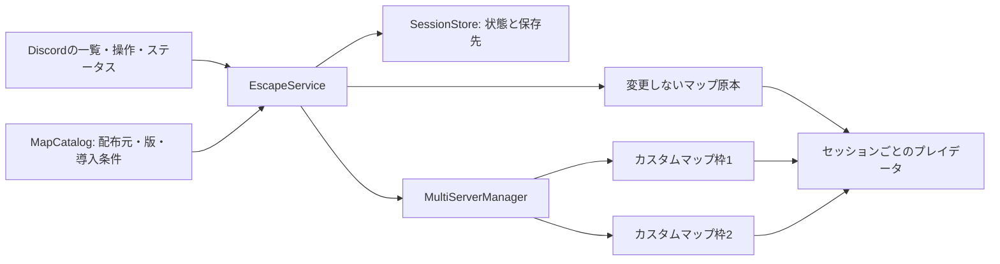

# カスタムマップ運用の調査・更新案

調査日: 2026-10-25。実機確認: 同日22:39 JST。

実装時の確定事項: 接続ポートは利用者の承認により25566・25567をForge系と排他共有する。運用手順は [カスタムマップの運用](custom-maps-operations.md)、受入結果は [カスタムマップの受入確認](custom-maps-verification.md) を参照する。

改訂: 人数・難易度・所要時間の検索、プレイ履歴、クライアント準備支援、マルチ限定の採用条件を追加した。利用者向けの画面・検索仕様・履歴・準備手順の詳細は [Discord UX・検索・参加準備の設計](escape-discord-ux.md)を正とする。

表示名は「カスタムマップ」とし、Paper / Forge等の「通常サーバー」と区別する。入口・検索・履歴・準備・ステータスの表記はUX設計の命名規則に統一する。初期の対象はマルチ対応の脱出マップである。

Discord最新仕様の再確認に基づき、カスタムマップ用の新規画面はComponents V2と選択式Modalを使う。常設パネルと `/escape home` を入口とする。SDK対応・応答順序・画面の詳細は [プラットフォーム適用設計](escape-discord-platform.md)に記録した。

本書は要件整理と実装案である。実機への操作は読み取りのみであり、サーバーの起動・停止、設定変更、マップ配置は実施していない。マップの評価は配布ページの記述に基づく。配布アーカイブの全件取得、同梱説明書の精査、専用サーバーでの試遊は今後の受入作業である。

## 1. 推奨方針

既存Discord Botに「カスタムマップ」の管理機能を追加する。配布マップの原本、プレイ途中のセッション、実際に起動する枠を分離する。

- 作者指定のMinecraftバージョンで、セッションごとに独立したVanillaサーバーを起動する。初期採用はマルチ対応作品とし、ForgeやクライアントModが必須の例外作品は採用しない。専用リソースパックと自動設定可能なサーバー条件には対応する。
- 起動枠は当初2枠とする。保存済みセッションは枠数と切り離し、ディスク容量の範囲で保持する。
- `/escape create` で参加準備ルームを開き、参加者・条件を確定した開始操作で原本から作成する。起動確認後に接続先を案内する。`pause` は保存して停止し、`resume` は同じデータで今回の参加者を確認する再開準備を開く。
- `finish` は保存・停止成功後にクリア申告を記録し、`delete` はプレイ用データを復元可能なごみ箱へ移す。完全消去と容量回復は別に確認する。別マップへの切り替えでは旧回を中断するかクリア扱いにするか選択する。
- Discordにマップ名、セッション名、Minecraftバージョン、状態、接続先、参加者、最終保存時刻を表示する。
- 既存の `forge` / `forge-alt` とカスタムマップ用サーバーは排他とする。Paperとカスタムマップ1枠、またはカスタムマップ2枠を初期の並列運用候補とする。
- 人気順はクラフターズコロニーの「通算」を採用する。順位と採用リストは調査日付きで固定し、配布元の更新をプレイ途中のセッションへ自動適用しない。
- 人数・謎解き難易度・所要時間・配布元等を組み合わせた検索と並び替え、最近のプレイ履歴、中断からの再開を提供する。
- 各マップと保存済みセッションの指定版に対応する「参加準備」案内を提供する。公式Launcher、版の設定、作者のパック配布ページ、必要なクライアント設定へのリンクを表示し、ファイルの再配布を前提にしない。

単一Paper上に複数ワールドを載せる方式では、古いコマンド、データパック、セレクター、ゲームルールの互換性を確保できない。今回はバージョンごとの独立実行が適する。

## 2. 現状確認

### 実機

| 項目 | 確認結果 |
| --- | --- |
| アーキテクチャ / CPU | aarch64 / 3論理CPU |
| メモリ | 17.52 GiB、調査時のMemAvailableは6.27 GiB |
| swap | 無効 |
| ディスク | ルート45 GiB、使用26 GiB、空き約19 GiB |
| 稼働中Minecraft | `forge` のみ、JavaのRSS約10.61 GiB |
| Paper | 停止中。最大ヒープ4 GiB、ポート25565 |
| Forge | 最大ヒープ14 GiB、ポート25566 |
| Forge Alt | 停止中。最大ヒープ12 GiB、ポート25567 |
| 導入済みJava | 17 / 21 / 25。Java 8 / 16は未導入 |
| systemdの制限 | BotサービスのMemoryMax / MemoryHigh / CPUQuotaは無制限 |
| ゲームプロセスの所属 | 現在は `discord-bot.service` のcgroupに所属 |

メモリ値は調査時点のスナップショットであり、ピーク値や並列運用試験の結果ではない。実機の `config.json`、`utils/server_manager.py`、`bot.py`、`cogs/status_display.py` は改行を正規化したSHA-256がローカルと一致した。

### 再利用できる機能と不足点

| 対象 | 現状と変更理由 |
| --- | --- |
| `utils/server_manager.py` | 複数サーバーの起動・停止、RCONによるready確認、操作ロック、PID識別、desired stateを再利用できる。セッションと起動枠の関連付けは未実装である。 |
| メモリ判定 | 現在は `MemAvailable >= Xmx × 0.8` である。単一サーバー限定の強制ルールではなく、条件を満たせば複数起動できる。JVMのネイティブ領域、既存プロセスの将来のヒープ増加、ホスト用余裕は予算化していない。割り当て値を読めない場合は判定をスキップする。 |
| 起動の直列化 | `_start_admission_lock` は起動確認完了まで保持される。起動処理の競合を抑える機構であり、起動後の並列実行を禁止する機構ではない。 |
| JVM設定 | jar直接起動は `Xms=Xmx` である。カスタムマップ用には最小ヒープと最大ヒープを分ける必要がある。Xmxはプロセス全体の使用メモリ上限ではない。 |
| `cogs/status_display.py` | 3分ごとにサーバー名、稼働状況、CPU、RSS、参加者を表示する。マップ名や保存状態は保持していない。参加者情報はログ依存であり、Bot再接続時はRCONによる補正が必要である。 |
| TPS / MSPT | `get_tick_stats()` は現在 `forge tps` を使う。Vanillaの旧バージョンでは共通取得できないため、対応アダプターがない場合は取得不可と表示する。 |
| コマンド選択肢 | `SERVER_IDS` と `SERVER_CHOICES` は静的である。マップの増加に対応する検索・ページ送り・autocompleteが必要である。 |
| バックアップ | 既存処理は固定サーバーIDと設定済み対象ディレクトリが基準である。起動枠を再利用しても、別セッションのバックアップを上書き・復元しない識別方法が必要である。 |
| デプロイ / OS再起動 | 起動状態の保存、停止、復旧確認が既に存在する。カスタムマップのセッションも共有の設定解決処理を経由し、保存データと起動対象を復元する必要がある。 |
| OSユーザー / ネットワーク | 現在のユーザー作成・sudo設定は既存3サーバー用である。カスタムマップ枠の専用ユーザーと通信許可の追加が必要である。 |

## 3. 配布マップの調査

### クラフターズコロニー: 通算人気上位15作品

[通算人気1ページ目](https://minecraft-mcworld.com/category/je/je-worlds/je-escape/?sort=all)と[2ページ目](https://minecraft-mcworld.com/category/je/je-worlds/je-escape/page/2/?sort=all)の表示順を採用した。週間・月間、DL数順、いいね順とは区別する。以下の「候補」は配布ページ上の適合を示し、起動検証済みを意味しない。

| 順位 | 作品 / 配布ページ | 指定MC | 共同プレイ・導入条件 |
| --- | --- | --- | --- |
| 1 | [深海からの脱出](https://minecraft-mcworld.com/104762/) | 1.21 | Vanilla、1～5人推奨、リソースパックなし。1.21.4以降の動作に注意書きあり。最初の検証候補である。 |
| 2 | [からくらり無人島](https://minecraft-mcworld.com/1485/) | 1.16.5 | マルチ対応。マルチ用リソースパックを各参加者へ導入する。外部配布先の取得可否は未検証である。 |
| 3 | [ドズル社からの脱出](https://minecraft-mcworld.com/13244/) | 1.18.2 | マルチ対応。全員OP、コマンドブロック有効、アドベンチャーでの開始、専用リソースパックが必要である。 |
| 4 | [事故物件-HousePhobia](https://minecraft-mcworld.com/45516/) | 1.12.2 | 調査記録のみ。ForgeとOptiFine必須のため初期採用から除外する。特別プロファイルは実装しない。 |
| 5 | [廃無村と壊れた気球](https://minecraft-mcworld.com/88048/) | 1.21 | 1～6人。専用リソースパック必須である。 |
| 6 | [駅からでられなくなりました･･･](https://minecraft-mcworld.com/62276/) | 1.20.1 | 1～5人。団体行動が必要である。マルチでパックが適用されない場合は作者の別配布パックを導入する。 |
| 7 | [沈まぬ街の大魔法](https://minecraft-mcworld.com/1288/) | 1.16.5 | マルチ可、ソロ前提の設計である。Modなし、アドベンチャー、ピースフル、コマンドONである。 |
| 8 | [夏の肝試し](https://minecraft-mcworld.com/16474/) | 1.18.2 | ソロ・マルチ対応。作者がワールドやリソースパックの重さに言及しており、軽量と決めつけず計測する。 |
| 9 | [禁域のアビス](https://minecraft-mcworld.com/128301/) | 1.21.4 | 1～4人。付属 `server.properties` の使用と指定リソースパックが必要である。マップ設定を保存し、ポート・RCON等の運用項目だけを調整する。 |
| 10 | [この家には玄関がない](https://minecraft-mcworld.com/192843/) | 1.21.11 | 1～7人、4～6時間想定。作者の修正版に無人時の時間経過への対処が含まれる。採用ファイルの版を固定する。 |
| 11 | [月の屋敷](https://minecraft-mcworld.com/4141/) | 1.17.1 | シングル・マルチ対応。同梱パック必須。Javaランタイムを個別確認する。 |
| 12 | [喪失メロディア](https://minecraft-mcworld.com/1190/) | 1.16.4 | マルチ可。ダウンロード先はPV概要欄を経由するため、最初の登録時に取得先を確認する。 |
| 13 | [青鬼の館からの脱出](https://minecraft-mcworld.com/8786/) | 1.18.1 | マルチ対応の明示がないため初期採用から除外する。調査記録のみ保持する。 |
| 14 | [現世忘れの美術館](https://minecraft-mcworld.com/141541/) | 1.21.5 | マルチ向けパック手動導入の説明がある。Realms非対応。専用サーバーでのレシピ・ギミック検証が必要である。 |
| 15 | [おんりーハウスからの脱出](https://minecraft-mcworld.com/159498/) | 1.21.4 | マルチ非対応のため採用から除外する。一般利用者の検索結果には表示しない。 |

通算人気の順位は調査記録として残す。利用者の一覧には採用・検証済みのマルチ対応作品だけを表示し、除外作品や検証待ち作品は管理者用カタログに閉じる。初期の15本は順位を繰り下げて補充し、試遊不合格の場合はさらに次順位を調べる。現時点で15本の起動確認が完了したという意味ではない。

| 補充順位 | 作品 | 調査結果 |
| --- | --- | --- |
| 16 | [怪盗Xからの挑戦状](https://minecraft-mcworld.com/140604/) | 1.21.4、マルチ可。マルチ用パック、描画・演算距離10チャンク以上の指定がある。15位の代替候補である。 |
| 17 | [黒猫に導かれて](https://minecraft-mcworld.com/119894/) | 1.21.4、パックなし。作者はマルチを想定しているが実環境では未確認と説明しているため、追加検証候補である。 |
| 19 | [春風の屋敷](https://minecraft-mcworld.com/8108/) | 1.18.x、マルチ対応、目安3～4時間。同梱パック必須。正確なパッチ版と人数範囲を確定して検証する。18位の作品はマルチ対応の明示がないため初期候補に含めない。 |

上位15件から4・13・15位を除き、16・17・19位を加えた15作品を初期検証候補とする。17位は作者のマルチ想定と本サーバーでの検証を区別し、検証合格までは非公開とする。既存候補の外部リンク切れや互換性不合格が判明した場合も、例外対応を増やさず次のマルチ対応候補で補充する。

### プラム太郎の群れ（旧サイト名を含む）

[トップページ](https://gerogero2.sakura.ne.jp/index.html)からリンクされた21作品の個別仕様を確認した。うち脱出作品の共同プレイ候補は13作品である。シングル専用・前提・サポート外の6作品と、人狼風ゲーム・迷路の2作品は初期採用から除外する。下表は調査記録であり、一般利用者の一覧ではない。

| 作品 / 個別仕様 | 指定MC | 初期の扱い |
| --- | --- | --- |
| [桟橋](https://gerogero2.sakura.ne.jp/mapdata/hashi.html) | ページ表記 `1.26.2` | マルチ対応。ただし公式manifestに `1.26.2` は存在せず、`26.2` は存在する。表記を推測で補正せず、同梱説明書とワールドデータで確定する。 |
| [離れでの秘め事 ReStart](https://gerogero2.sakura.ne.jp/mapdata/take2.html) | 26.2 | マルチ対応。トップの表記と個別仕様に差があるため、個別仕様・配布物を照合する。 |
| [オットセイは２号室](https://gerogero2.sakura.ne.jp/mapdata/ottosei2.html) | 1.21.1 | マルチ対応。 |
| [ピラミッド01](https://gerogero2.sakura.ne.jp/mapdata/pyramid_01.html) | 1.20.4 | マルチ対応。マルチでは難易度が上がる旨の記載あり。 |
| [その謎解きは貸出中です。](https://gerogero2.sakura.ne.jp/mapdata/book.html) | 1.20.4 | マルチ対応。 |
| [ほくそ笑むリャマ](https://gerogero2.sakura.ne.jp/mapdata/llama.html) | 1.19.4 | マルチ対応。 |
| [オットセイは１号室](https://gerogero2.sakura.ne.jp/mapdata/ottosei.html) | 1.18.1 | マルチ対応。 |
| [英雄墓地からの脱出 Remake](https://gerogero2.sakura.ne.jp/mapdata/eiyu_re_3.html) | 1.16.5 | マルチ対応。長編であり、中断・再開の検証に適する。 |
| [離れでの秘め事](https://gerogero2.sakura.ne.jp/mapdata/take.html) | 1.15.2 | マルチ対応。ReStartとは別マップIDで管理する。 |
| [Magic Cube Prime](https://gerogero2.sakura.ne.jp/mapdata/cube.html) | 1.14.4 | マルチ対応。 |
| [ゲロゲロ様のナワバリ２](https://gerogero2.sakura.ne.jp/mapdata/gero2.html) | 1.12.2 | マルチ対応。 |
| [けむりの街への片道切符](https://gerogero2.sakura.ne.jp/mapdata/clock.html) | 1.11.2 | マルチ対応。 |
| [最後の教室](https://gerogero2.sakura.ne.jp/mapdata/class.html) | 1.9.2 | マルチ対応。ただし初期位置がずれる可能性が明記されている。スポーン復元を試験する。 |
| [悪魔審問](https://gerogero2.sakura.ne.jp/mapdata/akuma.html) | 1.14.4 | シングルのみ。 |
| [スノウリーパー](https://gerogero2.sakura.ne.jp/mapdata/snow.html) | 1.11.2 | シングル専用、マルチ動作不能との記載あり。 |
| [悲鳴の聞こえる祭壇](https://gerogero2.sakura.ne.jp/mapdata/himei.html) | 1.10.2 | シングル向け、マルチサポート外。 |
| [真 英雄墓地からの脱出](https://gerogero2.sakura.ne.jp/mapdata/eiyu2.html) | 1.8.8 | シングル専用。 |
| [ゲロゲロ様のナワバリ](https://gerogero2.sakura.ne.jp/mapdata/gero1.html) | 1.8.3 | シングル前提。 |
| [英雄墓地からの脱出](https://gerogero2.sakura.ne.jp/mapdata/eiyu1.html) | 1.8.8 | シングル専用。 |
| [ゾンビねだやし](https://gerogero2.sakura.ne.jp/mapdata/zombie.html) | 1.20.X | 人狼風ゲーム。今回の脱出マップの初期採用には含めない。 |
| [ダムドパンプキンヘッド](https://gerogero2.sakura.ne.jp/mapdata/pumpkin.html) | 1.19.1 | 迷路。今回の脱出マップの初期採用には含めない。 |

シングル専用作品は、人数制限を1人にするだけで専用サーバー対応になるとは限らない。今回の一般向け一覧・参加準備・起動対象には含めない。[作者の導入説明](https://gerogero2.sakura.ne.jp/how_to_setting.html)でも、対応バージョン以外で開かないよう指定されている。版表記に不一致がある作品は原本で解消できるまで非公開とする。

## 4. データと実行環境の分離



起動枠とセッションは別IDである。1つのセッションを同時に複数枠へ割り当てない。途中保存したセッションを停止して枠を解放すれば、別マップを遊んだ後でも元のセッションに戻れる。同じマップを別グループが遊ぶ場合は原本から別セッションを作成する。

### 配置案

```text
/opt/minecraft/escape/
  artifacts/                 Vanilla Minecraftの固定バージョン
  downloads/                 取得した原本アーカイブと検証ハッシュ
  templates/<map-id>/<rev>/   検証済み・変更しない展開済み原本
  sessions/<session-id>/     各回のworld・設定・参加者情報
  backups/<session-id>/      中断・削除前の復元用データ
  trash/<session-id>/        同一ファイルシステムの復元可能な退避
/opt/minecraft/.bot-runtime/
  escape.sqlite3            セッション、操作ジョブ、枠、監査情報
```

ゲームデータはBotのrsync対象ディレクトリ外に置く。セッションの `server` ディレクトリを、その回の `ServerInstance.cwd` とする。枠が保持するポート・Unixユーザーと、セッションが保持するjar・Java・メモリ条件を、共有の設定解決処理で組み合わせる。操作のたびに公開 `config.json` を書き換える方式は採用しない。

### カタログ

`escape-maps.json` 等の宣言的なカタログを追加する。公開メタデータと、非公開の配置先・認証情報を分離する。

- 安定した `map_id`、表示名、作者、配布ページ、出典サイト、ジャンル、採用時の順位・日付。
- マップ改訂番号、正確なMinecraft版、実行方式（初期はVanillaのみ）、Javaプロファイル、配布物のハッシュ、原本内のワールド位置。
- 作者の対応人数・推奨人数・本サーバーの検証人数を分離し、検索と起動で同じ運用範囲を使う。謎解き難易度、所要時間の上下限、原文、評価の出典と確認日を保存する。
- リソースパック、OP要否、作者指定設定、参加準備手順、配布リンク、リンク確認状態を保持する。クライアントModが必須の作品は初期採用対象外とする。
- メモリプロファイル、試遊結果、最終検証日、`candidate / verified / unavailable / unsupported` 等の採用状態。

新しいマップはカタログと検証済み原本の追加で登録できる構成とする。特殊な導入方式のみアダプターを追加する。ページ解析は候補の発見・更新検出に利用し、未確認のダウンロードや実行環境をそのまま一般ユーザーの起動対象にしない。

作者の更新を取り込むときは原本の新しい改訂として登録する。進行中のセッションには原本・jar・Java・リソースパックの版を固定して保持する。順位変動で既存セッションを削除したり、起動環境を置き換えたりしない。

## 5. Discordの操作と表示

| 操作案 | 動作 |
| --- | --- |
| `/escape home` | 本人用の「マップを探す」「続きから」「最近のプレイ」「参加準備」を表示する。常設パネルからも開ける。裸の `/escape` は実行用入口にしない。 |
| `/escape maps` | 人数、謎解き難易度、所要時間、配布元等で絞り込み、人気・難易度・時間・対応人数・最近のプレイで並び替える。 |
| `/escape history` | 自分または閲覧可能なグループの最近のプレイを表示する。中断は再開、完了・削除済みは同マップの新規作成に案内する。 |
| `/escape setup` | マップまたは保存セッションの正確な版に対応する参加準備を表示する。Windows / macOS / Linuxの手順と公式・作者リンクを提供する。 |
| `/escape create map name` | 指定内容を入力した参加準備ルームを開く。即時起動しない。 |
| `/escape start room` | 今回の参加者・承認済みUUID・条件を確定し、枠と予算を確保して新規作成または再開する。ボタンによる開始も同じ処理を呼ぶ。 |
| `/escape sessions` | 稼働中・中断中・完了済みを一覧表示する。中断中は接続不能であることと、再開操作を明示する。 |
| `/escape pause session` | 接続者への予告、保存、正常停止、プロセス終了確認を行い、中断状態にする。 |
| `/escape resume session` | 保存データと固定要件を使った再開準備を開く。今回の参加者を確定してから同じIDのデータで開始し、原本で上書きしない。 |
| `/escape finish session` | 保存・正常停止成功後にクリア申告を確定する。クリア判定は利用者の申告である。完了済みからの通常再開は提供しない。 |
| `/escape delete session` | 対象名を示す確認後、停止済みデータを同一ファイルシステムのごみ箱へ移す。未クリアなら途中終了として記録し、原本と他セッションには触れない。 |
| `/escape switch session map` | 旧回を中断して残すか、クリアして残すかを選び、新マップの準備へ進む。新マップの検証・準備が失敗した場合も旧データを保持する。 |

操作は既存のguild・ロール・ユーザー権限検証へ統合する。閲覧、作成・再開、中断、完了、削除、カタログ登録を区別し、セッション所有者・参加グループの範囲を確認する。全員OPが必要な作品では、そのセッションの参加者だけに適用する。

起動前の参加準備ルームを設け、マップの条件、予定人数、準備リンクを共有する。この段階ではワールド作成・起動枠予約を行わない。「この内容で開始」時に共通の起動判定を実行する。詳細はUX設計書に定義する。

初期化ジョブは永続化し、Discordへの応答期限と分離する。「ダウンロード中」「検証中」「ワールド作成中」「起動確認中」の段階を表示し、ready前にはプレイ可能と表示しない。重複操作と古いボタンは、ジョブID・セッションID・状態の世代番号で拒否する。

共通常設ステータスにはカスタムマップ枠の稼働・空きとホスト負荷だけを表示する。以下の詳細は、セッションの共有先と公開範囲を確認したプレイカードに表示する。既存の単一 `STATUS_CHANNEL_ID` へ非公開セッションの作品名・プレイ名・参加者・活動時刻・接続先を転送しない。

- マップ名とセッション名、配布元リンク、Minecraft版、必要なパック・Mod。
- 準備中 / 起動中 / プレイ可能 / 保存停止中 / 中断中 / 完了 / 異常停止の状態。
- 起動枠、接続アドレスとポート、人数、参加者、累計稼働時間、最終正常保存時刻。
- RSSと最大ヒープ、取得可能な場合だけTPS / MSPT。未取得値を正常値として表示しない。

状態の変化時は即時に表示を更新し、定期更新を補助に使う。既存の3分周期だけには依存しない。Bot再起動後は保存したメッセージIDとRCONの `list` を使って表示と参加者を再同期する。攻略の進捗率や自動クリア判定は共通仕様がないため、マップごとの明示的な検出アダプターを追加した場合に限る。

## 6. 中断・再開・削除の整合性

実行・保存状態と、クリア申告・途中終了の結果を分離する。状態遷移は次を基本とする。

```text
PREPARING -> STARTING -> RUNNING -> SAVING -> PAUSED
PAUSED -> STARTING -> RUNNING
RUNNING / PAUSED -> COMPLETED -> DELETING -> DELETED
PAUSED / FAILED -> DELETING -> DELETED（停止・データ確認済みの場合）
COMPLETED -> PAUSED（管理者がクリア申告を取り消す場合）
各処理の失敗 -> FAILED（直前の保存データと失敗理由を保持）
```

`result=unknown / clear_reported / abandoned` を状態とは別に保持する。クリア申告は保存・停止の成功後に確定し、失敗しただけで `clear_reported` にしない。未クリアの片づけは `abandoned` とし、`COMPLETED` を経由せず消去できる。`DELETED` にはごみ箱で復元可能か、完全消去済みかを別のデータ可用性として記録する。完了済み保存には通常の再開ボタンを付けず、誤申告の取消しは監査付きの管理操作とする。

- ワールド全体を保存する。地形に加え、プレイヤーのUUID・位置・インベントリ、advancements、stats、scoreboard、データパック、エンティティ、全ディメンションを対象とする。マップ固有のサーバー側データも登録対象に含める。
- 初期導入時はシングル用 `level.dat` 内のプレイヤーデータや開始地点も確認する。専用サーバーでは同じ開始状態にならない作品を無条件で対応済みにしない。
- 正常停止とデータ保存を確認してから `PAUSED` とする。強制終了時は正常保存済みと表示しない。
- 一覧上の中断はゲームの一時停止ではなくプロセスの停止である。無人でもコマンドブロックやタイマーが動く可能性があるため、利用者には明示的な中断操作を用意する。自動無人停止は作品別の試験後に追加する。
- 通常の消去は停止済みディレクトリを同一ファイルシステムのごみ箱へ原子的に移し、コピー用の空き容量を要求しない。DB更新と移動の途中失敗は操作記録から復旧する。初期案の保持期限は7日であり、復元可能な消去だけでは空き容量が増えないことを表示する。容量回復は期限到来のごみ箱回収、または対象名入力で確認した完全消去で行う。利用者が消去を選んでいない中断データは自動回収しない。
- セッション単位のロックに加え、枠割り当てとリソース予約を共有ロック・トランザクションで管理する。既存 `/start`、`/restart`、自動復旧、バックアップ後の再起動からも同じ判定を呼ぶ。
- 起動希望には枠IDだけでなくセッションIDと割り当て世代を記録する。Bot・ホスト再起動後に、再利用済みの枠で別セッションを誤起動しない。準備途中の残骸は成功データと区別し、再実行または回収できるようにする。
- 開始時の参加者スナップショットをホワイトリスト・OPへ反映する。準備中の辞退・除外と、過去の参加者データを分離し、旧UUIDや持ち物を消さず今回の参加者だけで開始条件を判定する。

バックアップ名と復元メタデータは `session_id + map_revision + runtime_version` を保持する。既存のサーバーIDだけから推定する復元方式をカスタムマップのセッションへ流用しない。中断中のセッションもバックアップ対象とし、SQLiteの整合したスナップショットと各セッションの対応を保存する。Notionへの保存は既存のアップロード機構を再利用できる。

## 7. 同時実行とメモリ方針

Mod数が少なくても、常時実行のコマンドブロック、エンティティ、描画・演算距離、ギミックで負荷が上がる。実機は3 CPUであり、メモリが余っていても並列数を増やせるとは限らない。

### 初期の組み合わせ

| 組み合わせ | 提案 |
| --- | --- |
| 既存Forge / Forge Alt + カスタムマップ | 拒否する。既存Forgeの起動要求側にも同じ排他判定を入れる。稼働中のゲームを自動停止しない。 |
| 既存Forge / Forge Alt + Paper | 既存運用の単独起動方針を明示的なルールにする。 |
| Paper + 小規模なカスタムマップ1枠 | 初期の並列運用候補。両方に参加者がいる条件で検証して有効化する。 |
| 小規模なカスタムマップ2枠 | 同上。1枠ずつ起動して起動負荷の重複を避ける。 |
| Paper + カスタムマップ2枠 | 当初は制限する。メモリ上は収まる場合があるが、3 CPUでの継続負荷試験後に判断する。 |

初期値の案は、小規模用 `Xms=512M / Xmx=2G / 予約3 GiB`、中規模用 `Xms=1G / Xmx=3G / 予約4.5 GiB` とする。これは実測前の仮値であり、作者指定距離を下げたり、作品を一律2 GiBで公開したりしない。PaperはXmx4 GiBにネイティブ領域の余裕を加えて予算化する。

軽量環境の起動判定では、次の両方を満たすことを要求する。

1. 稼働中・起動中・新規の予約メモリ合計にホスト用の余裕（仮に3 GiB）を加え、物理メモリ内に収まる。
2. `MemAvailable` が、新規の予約分、既存プロセスが予約値まで増える余地、緊急用余裕を賄える。

予約値はヒープとネイティブ領域を含む。現在のRSSだけで起動可否を決めない。割り当て値やランタイムが不明な新規環境は起動を拒否し、明示設定を要求する。利用者の中断・完了では停止確認後に予約を解放する。起動失敗・異常終了・Bot再起動での再構築も扱う。

バックアップ、再起動、デプロイ、OS保守の一時停止では、元のセッションID・割り当て世代・保守ジョブに対する枠とメモリ予算を保守リースとして永続保持する。Forgeの排他も一時停止中に解放しない。新規起動はこの予約を含めて判定し、元の回の復帰枠を奪わない。復帰操作だけがそのリースを再利用し、元に戻るまで別ジョブへ譲らない。復帰不能時は失敗状態を通知し、管理者が保存データとプロセス停止を確認して、中断へ移すか復旧を続けるかを選ぶ。リースの単純な期限切れで別回を自動起動しない。

既存Forgeは14 GiB、Forge Altは12 GiBのため、軽量用の仮予算を一律適用すると現在の起動を拒否する可能性がある。初回実装では既存Forgeのヒープと起動条件を維持し、軽量枠から除外して排他制御を適用する。大型環境の予算統一やヒープ削減はピーク計測後の別変更とする。

現在の80%条件は「厳しい固定制限」ではなく、ヒープ全量より少ない空きでも起動を許す条件である。この係数をさらに下げる変更は行わず、環境別の設定と予約で同時実行を可能にする。プロセスごとのcgroup上限を追加する場合は、現在のBotとゲームが同一cgroupである点も変更する必要がある。XmxだけをOSレベルの分離と扱わない。

### 計測

代表マップで、起動時ピーク、2～5人程度での探索・ギミック動作、保存・再開、Paper併用を確認する。RSS、MemAvailable、CPU、GC、取得可能なTPS / MSPT、クライアントでの遅延を記録する。メモリ圧迫時は新規起動を止め、原因をDiscordへ表示する。負荷計測のために既存Forgeを無断停止しない。

## 8. 導入条件と運用上の扱い

- MinecraftとJavaはバージョン別に固定する。[Mojang公式manifest](https://piston-meta.mojang.com/mc/game/version_manifest_v2.json)から各版のmetadataを確認した結果、1.16.5以前はJava 8、1.17.1は16、1.18～1.20.4は17、今回対象の1.21系は21、26.2は25であった。
- Java 8のARM用配布は[Amazon Corretto公式配布一覧](https://docs.aws.amazon.com/corretto/latest/corretto-8-ug/downloads-list.html)等を利用できる。1.17.1を既存Java 17で動かす案も試験対象とし、未試験の互換性を前提にしない。
- jarは公式配布元とハッシュを検証して保存する。マップZIPも取得時のハッシュと改訂番号を記録する。採用済みハッシュと異なるファイルは更新候補として扱う。
- 外部配布先に確認画面や取得失敗がある場合、管理者による原本登録を可能にする。初回登録後はローカル原本から作成し、毎回サイトへアクセスする設計を避ける。
- ZIPは一時領域で展開し、絶対パス・親への遡り・シンボリックリンク等を拒否する。展開容量、空き容量、`level.dat`、原本内の階層を確認する。同梱スクリプトを自動実行しない。
- 作者指定の `server.properties`、ゲームルール、難易度、距離設定を保持する。接続ポート、RCON、認証、ホワイトリスト等の運用項目だけを明示的に差し替える。作品側の条件と競合する場合は検証待ちにする。
- `resources.zip` の同梱だけでは専用サーバーの参加者へ適用されない場合がある。パックの導入方法・版・ハッシュを案内し、配布条件を確認した方法で提供する。二次配布禁止の作品を公開Gitや共通の公開ミラーへ再配置しない。
- オンライン認証と承認済みのDiscordユーザー・Minecraft UUIDの対応付けを使い、同じUUIDで進行データを再開する。各回のホワイトリストと必要なOPは確定した今回の参加者に限定し、既存の全体ホワイトリストを無条件に複製しない。
- 初期接続はJava版の指定バージョンを使う。現行PaperのGeyser経由の接続可否は脱出マップとは別に検証する。
- クライアント準備案内はサーバー側Javaの導入手順と分離する。通常の公式Launcher利用者には正確なMC版の起動構成を案内し、サーバー用JDKやModローダーの導入を要求しない。
- ゲームポートは仮に25568 / 25569、RCONは25578 / 25579とする。調査時にこれらのTCP待受はなかったが、OCI Security List / NSG、ホストのファイアウォールは追加確認が必要である。RCONは外部公開しない。
- 同じホスト名と枠ごとのポートをDiscordに表示する。中断時には旧接続先を無効表示にし、再開時はポートが変わり得ることと今回の接続先を明示する。プロキシによる単一接続先への統一は将来拡張とし、初期導入には含めない。
- 保存セッション数はメモリと切り離せるが、空きディスクは約19 GiBである。原本・展開物・セッション・バックアップ・ごみ箱の合計に上限を設ける。新規作成は展開・保存に必要な容量を判定し、容量不足時も同容量の削除前コピーを必須にしない。ごみ箱の保持と完全消去による容量回復を明示する。

## 9. 実装単位と受入条件

### 変更箇所

| 対象 | 更新内容 |
| --- | --- |
| 新規カタログと検証ツール | マップ条件、人数・難易度・時間の出典付きメタデータ、固定版、取得・展開・原本登録、参加準備リンクを管理する。 |
| 新規 `utils/escape_service.py` / session store | 永続状態、準備ルーム、初期化、再開、完了、削除、原本と実行環境の対応を管理する。 |
| 新規検索 / 履歴 / 準備サービス | 絞り込み・並び替え、不明値、閲覧権限付き履歴、セッションに固定した参加準備を実装する。 |
| 新規 `cogs/escape.py` | ホーム、検索、履歴、準備、操作ジョブ、確認ボタン、権限を提供する。 |
| `utils/server_manager.py` | Xms / Xmxの分離、枠とセッションの関連付け、共通の排他・予約判定、状態イベントを追加する。 |
| `cogs/status_display.py` / `cogs/basic_control.py` | マップ情報、接続条件、状態変化の即時反映、汎用起動経路からの判定を追加する。 |
| `settings.py` / `utils/runtime_config.py` | 静的サーバーとセッションの共有設定解決、動的な選択肢を追加する。 |
| `cogs/backup_system.py` | セッション単位のバックアップ・復元と中断データの保持に対応する。 |
| `bot.py` / 保守・復旧スクリプト | 初期化途中の復旧、セッションを特定した起動希望、正しいready確認に対応する。 |
| Ansible / systemd / デプロイ | 専用ユーザー、権限、Java、保存先、停止・復旧対象、ネットワーク設定を整える。 |

### 実装順

1. カタログ、原本、セッションのデータモデルと導入検証を実装する。まず「深海からの脱出」「英雄墓地Remake」「ドズル社からの脱出」で、異なる世代・保存・パック・OP条件を確認する。
2. 1枠で作成・起動・中断・再開・完了・削除とDiscord表示を完成させる。
3. バックアップ、Bot再起動、デプロイ、OS再起動の復旧まで統合する。
4. Forge排他、リソース予約、2枠目を追加し、Paper併用とカスタムマップ2枠を負荷試験する。
5. 各候補の試遊結果と検索メタデータを記録し、マルチ対応作品を15件程度に補充して公開する。除外・検証待ち作品は管理者用カタログだけに残す。

### 必須の受入確認

- 新規作成は毎回原本と同じ開始状態となり、原本と他セッションを変更しない。
- 複数人で仕掛けを進め、中断・Bot再起動・ホスト再起動を経てもアイテム、位置、scoreboard、進行が一致する。
- 枠を別セッションに再利用しても、元セッションを正しいMinecraft版とデータで再開できる。
- 完了後の消去・別マップ作成が可能であり、作成失敗や容量不足では旧データが失われない。
- 起動・再開・削除の同時要求、古いボタン、ダウンロード失敗、展開中断、ready失敗から復旧できる。
- 既存 `/start`、`/restart`、自動復旧、バックアップ復帰の全経路でForge排他とリソース予約が働く。
- 起動中・停止中・異常終了をDiscordで正しく表示し、未検証の進捗や保存成功を表示しない。
- 人数・難易度・時間の検索と並び替え、不明値、履歴、OS別の参加準備、旧セッションの版固定、リンク切れの受入確認はUX設計書の試験例を満たす。
- Paper併用と2枠運用の負荷試験で、メモリ不足、OOM、継続的な遅延が発生しない。
- 本番コード変更時は既存の単体テストとruffを実行し、ライフサイクル、復旧、排他、データ分離の回帰試験を追加する。

## 10. 実装前に残る確認

配布アーカイブの同梱条件、取得可能性、正確な原本改訂、桟橋等の版表記の不一致、リソースパックの提供条件、旧JavaのARM上の起動、OCIの通信許可、実負荷時の並列性能が未確定である。人数・難易度・時間は未記載や出典間の尺度差があるため、出典を保持して入力・検証する。これらはカタログの検証状態として管理し、未確認作品をプレイ可能と表示しない。Forge 1.12.2等の例外環境は今回の検証対象に含めない。
